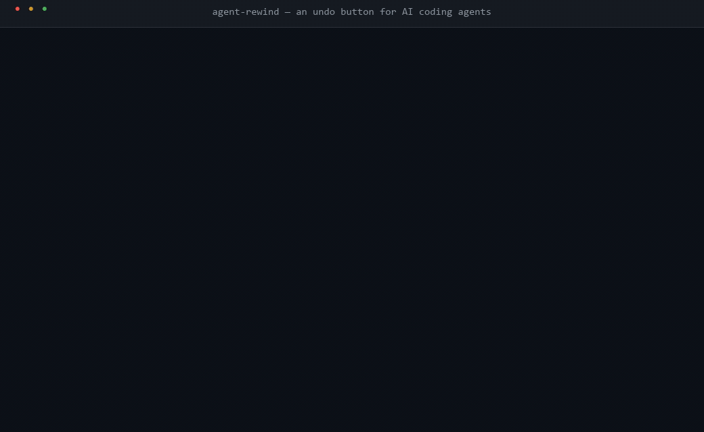

# agent-rewind

**An undo button for AI coding agents.**

<p align="center">
  <a href="https://www.npmjs.com/package/agent-rewind"></a>
  <a href="https://github.com/PHclaw/agent-rewind/stargazers"></a>
  <a href="LICENSE"></a>
  
  
</p>

> Your agent just "refactored" your repo into rubble. `agent-rewind` snapshots everything automatically — one command and you're back.

## 🎬 Demo

<!-- Replace with demo.gif once recorded (see docs/demo-script.md) -->


```
$ agent-rewind start --agent claude-code
✓ watching /repo — snapshot every 30s

# ... agent works, snapshots pile up ...
✓ k3f9ab  14:32:01  agent:claude-code  4 files +312 −187
✓ k3f9cd  14:32:31  agent:claude-code  2 files +12 −96

# ... disaster strikes ...
$ agent-rewind ls
ID          TIME                 AGENT         FILES  CHANGES
k3f9cd      10-19 14:32:31       claude-code      2  +12 −96
k3f9ab      10-19 14:32:01       claude-code      4  +312 −187

$ agent-rewind go 5m
⏪ rewinding to k3f9ab (2026-10-19 14:32:01, 4m ago)
   4 file(s) differ from that snapshot
   safety snapshot: m4x2cd
✓ restored 4 file(s)
   undo this rewind: agent-rewind go m4x2cd
```

## Why

AI coding agents (Claude Code, Codex, Cursor, …) make hundreds of file changes per session. Git doesn't save you:

- agents commit messily — or not at all
- `git stash` fights with the agent's own changes
- `git reset --hard` nukes **your** work along with the agent's

You need a safety net that:

- **snapshots automatically** — no git hygiene required, no discipline
- **is agent-aware** — knows which agent/session made which change
- **rewinds in one command** — including undoing the rewind itself
- **never touches your git state** — branches, HEAD, history and staging area stay exactly as they were

## 30-second quick start

```bash
# 1. in any repo (works in repos with no commits yet, too)
npx agent-rewind start --agent claude-code

# 2. let your agent work — checkpoints pile up every 30s, or on demand:
agent-rewind once --agent codex --msg "before deploy"

# 3. disaster? rewind:
agent-rewind ls
agent-rewind go 5m
```

That's it. No config, no daemon, no cloud.

## How it works

- Snapshots are **real git commits on hidden refs** (`refs/agent-rewind/*`) — fast, deduplicated, and unchanged files cost nothing extra
- Your branches, `HEAD`, history and staging area are **never touched** (restores use a throwaway index)
- Every rewind takes a **safety snapshot first**, so Ctrl+Z works on Ctrl+Z
- Snapshots are **byte-exact** — no line-ending rewriting, ever (`core.autocrlf=false` is forced)
- Metadata lives in `.agent-rewind/` (local only; add it to `.gitignore` if you like)
- Zero runtime dependencies. One file to audit.

## Commands

| Command | What it does |
|:--------|:-------------|
| `start [--agent X] [--every 30s]` | Watch the repo and auto-snapshot on a timer (Ctrl+C to stop) |
| `once [--agent X] [--msg "..."]` | Take a single snapshot — perfect for hooks and CI |
| `ls [--json]` | List snapshots: id, time, agent, files, +/− |
| `go <id\|10m\|2h\|14:30> [--prune] [--yes]` | Roll back to a moment in time |
| `diff [<a>] [<b>] [--full]` | What changed between snapshots |
| `status` | Snapshot count and latest state |
| `hooks` | Copy-paste config for Claude Code / Codex / custom agents |

`go` accepts a snapshot id, a relative time (`10m`, `2h`, `1d`), a clock time (`14:30`), or an absolute date (`2026-10-19 14:30`).

## Works with any agent

```bash
# Claude Code — snapshot after each turn (.claude/settings.json)
{
  "hooks": {
    "Stop": [
      { "hooks": [{ "type": "command",
        "command": "npx agent-rewind once --agent claude-code --msg \"turn done\"" }] }
    ]
  }
}
```

```bash
# Any agent / CI — snapshot around a run
agent-rewind once --agent my-bot --msg "before run"
# ... run your agent ...
agent-rewind once --agent my-bot --msg "after run"

# Codex / Cursor / custom agents — run the watcher in a second terminal
agent-rewind start --agent cursor
```

## Comparison

| | agent-rewind | `git stash` | `git reset --hard` | IDE local history |
|:--|:--|:--|:--|:--|
| Automatic snapshots | ✅ timer | ❌ manual | ❌ | ✅ (editor only) |
| Survives agent chaos | ✅ | ❌ | ❌ | partial |
| Cross-agent, cross-tool | ✅ | — | — | ❌ |
| Leaves git state untouched | ✅ | ✅ | ❌ | ✅ |
| Rewind is itself undoable | ✅ | ❌ | ❌ | ❌ |
| Terminal-native, scriptable | ✅ | ✅ | ✅ | ❌ |

## Roadmap

- [ ] Event-driven snapshots (fs.watch), not just interval
- [ ] `git gc` retention policy helper (`agent-rewind gc`)
- [ ] Snapshot bundles: export/import a rewind point
- [ ] Web UI for browsing snapshot history

## Development

```bash
npm install
npm run build
npm run smoke   # 46 end-to-end checks in throwaway git repos
```

`git` must be installed. If `git` is not on your `PATH`, set `AGENT_REWIND_GIT=/path/to/git`.

## FAQ

**Does this replace git?** No. It sits on top of it. Your workflow doesn't change.

**Where is the data stored?** `.agent-rewind/` inside your repo, plus git objects referenced by `refs/agent-rewind/*` (safe from `git gc` as long as the refs exist).

**How do I delete snapshots?** `git update-ref -d refs/agent-rewind/<id>` and remove the line from `.agent-rewind/snapshots.jsonl`. Everything else is normal git.

**Windows?** Yes — tested on Windows with Git for Windows, including repos without any commits.

## License

[MIT](LICENSE)
